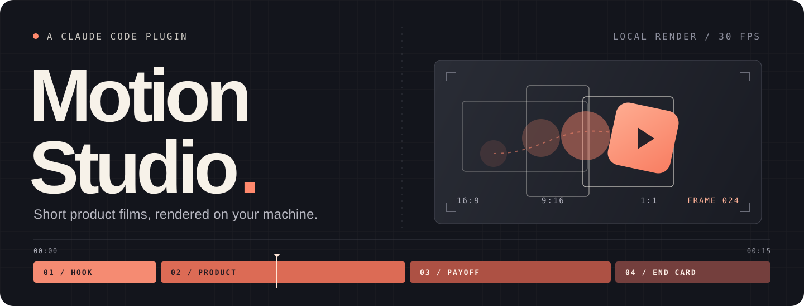
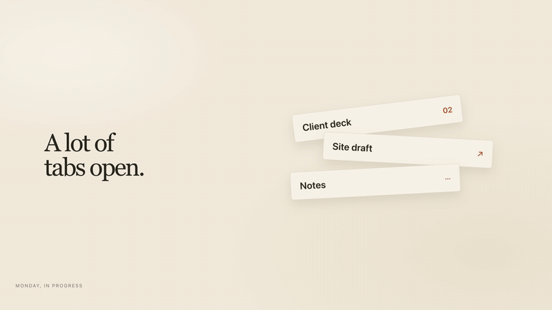

<h1 align="center">
  
</h1>

<p align="center">
  A Claude Code plugin for 15–60 second product ads and software demos.<br>
  From your brief to animation, generated sound and local rendering.
</p>

<p align="center">
  <code>Node&nbsp;22+</code> &nbsp; <code>Local&nbsp;rendering</code> &nbsp; <code>Zero&nbsp;npm&nbsp;dependencies</code> &nbsp; <a href="LICENSE">MIT&nbsp;licensed</a>
</p>

<p align="center">
  <a href="#install">Install</a> &nbsp; · &nbsp;
  <a href="#try-it">Try it</a> &nbsp; · &nbsp;
  <a href="#the-workflow">The workflow</a> &nbsp; · &nbsp;
  <a href="#reference">Reference</a> &nbsp; · &nbsp;
  <a href="#support-and-status">Support &amp; status</a>
</p>

## Install

Run these in **Claude Code**:

```text
/plugin marketplace add crankyjediii/motion-studio
/plugin install motion-studio@motion-studio
```

Restart Claude Code, then check your machine:

```text
/motion-studio:setup
```

The setup skill reports missing tools and asks before installing them. Use your existing Claude Code account; the plugin needs no separate API key or npm install.

**You’ll need:**

- **Claude Code**, signed in, with plugin support.
- **Node 22+** for the built-in WebSocket API.
- **Chrome, Edge or Chromium** for frame capture.
- **ffmpeg + ffprobe** on `PATH`, with `libx264`. Editable timeline export also needs `prores_ks`.

<details>
<summary><strong>Install rendering tools on macOS</strong></summary>

If you already use Homebrew:

```sh
brew install node ffmpeg
brew install --cask google-chrome
```

Otherwise use the platform downloads for [Node](https://nodejs.org/), [Chrome](https://www.google.com/chrome/) and [ffmpeg](https://ffmpeg.org/download.html). `/motion-studio:setup` can report the commands for your platform. Start Claude Code from a terminal where `ffmpeg` and `ffprobe` are available.

</details>

## Try it

<p align="center">
  
</p>

<p align="center"><sub>Sample output rendered locally with Motion Studio. Still is fictional; its interface is illustrative. This GIF is silent. MP4 exports include the soundtrack.</sub></p>

Start Claude Code in the folder where you want your production saved. A brief can be this specific:

```text
/motion-studio:studio Make a 15-second ad for Still, a fictional focus app.

Audience: freelance designers.
Features: reserve a 25-minute calendar block; mute notifications during it.
Look: warm paper and ink, illustrative UI, system fonts.
Sound: generated music and effects.
Message: "Make room to focus."
End card: still.example (a fictional demo URL).
Formats: horizontal, vertical, square.
Review: concept, storyboard and final preview.
```

Replace those facts with your own product details. Supply real screenshots, recordings, logos and guidelines as local file paths. The studio records which scenes use authentic footage and which are illustrative.

### Your film, in three frames

| Horizontal | Vertical | Square |
| :---: | :---: | :---: |
| **16:9** | **9:16** | **1:1** |
| 1920 × 1080 | 1080 × 1920 | 1080 × 1080 |

Timing and soundtrack are shared; each frame gets its own layout. Final exports are **30 fps H.264 MP4** with **AAC audio near −14 LUFS**. Drafts use half resolution.

## The workflow

1. **Concept.** One recommended idea, with the look, words and beats. You review it.
2. **Storyboard.** Scene timings and real style frames, composed for each format. You review those too.
3. **Production.** Music establishes the edit grid; animation and sound follow it.
4. **Quality checks.** Layout, media, provenance and rendered files are checked. Automatic correction stops after three failing rounds.
5. **Preview.** Play the film in a local browser, compare formats and leave notes on the frame that needs work.
6. **Delivery.** Final videos, browser source, assets, audio, QC results and `PROVENANCE.md` land in `deliverables/`.

The default is **guided** review at concept, storyboard and final preview. Ask for **final-only** to review just the preview, or **autonomous** to run through delivery. Skipped checkpoints are never recorded as approvals. A finished script or storyboard uses faithful direction; otherwise the studio proposes copy and pacing.

<details>
<summary><strong>Meet the five studio roles</strong></summary>

| Role | Responsibility |
| --- | --- |
| Creative director | Concept and storyboard |
| Motion engineer | Animation and composition in each format |
| Editor | Pacing, cut points and reading time |
| Sound designer | Generated music, effects and the mix |
| QC reviewer | Automated reports and visual frame review |

When delegation is unavailable, the producer performs these roles in order. The brief, concept and storyboard are saved in the production folder.

</details>

### Notes belong on frames

In the preview, **Space** plays or pauses, **← / →** steps frames and **N** focuses a timestamped note. Format and Live / Draft / Final controls switch the picture you review.

When your notes are ready, return to the same chat:

```text
/motion-studio:revise Notes are in. Apply the preview feedback to this project.
```

Or describe a change directly:

```text
/motion-studio:revise Hold the end-card logo half a second longer.
Make the CTA larger in the vertical version.
```

The revision skill inspects the affected frames, checks every format and resolves the notes it handled. Finish picture and sound edits before final rendering: changes invalidate previous renders, QC and final approval. Delivery requires current final QC for every project format. Older renders need one fresh render and QC pass to establish their source revision.

### Bring your brand

```text
/motion-studio:brand Create an Acme profile from ./brand/logo.svg,
./brand/font.woff2 and ./brand/guidelines.pdf.
```

Ask `/motion-studio:studio` to use that profile. A project uses one client’s brand. Profiles and shared components stay in `~/.motion-studio`, outside the plugin; set `MOTION_STUDIO_HOME` to use another store.

## Reference

| Skill | Use it for |
| --- | --- |
| `/motion-studio:setup` | Machine readiness and missing tools |
| `/motion-studio:studio` | A production from brief to delivery |
| `/motion-studio:brand` | Logos, fonts, colors and motion rules |
| `/motion-studio:revise` | Chat feedback and timestamped notes |

<details>
<summary><strong>CLI reference · all 20 commands</strong></summary>

From a cloned checkout, keep production projects outside the plugin directory:

```sh
node scripts/studio.mjs doctor
node scripts/studio.mjs init --dir ../my-ad --name "My ad" --duration 15
node scripts/studio.mjs status --project ../my-ad
```

Run the dispatcher without a command for usage. Commands return JSON on stdout and progress or failures on stderr. Project commands accept `--project <directory>`.

| Command | Purpose and main options |
| --- | --- |
| `doctor` | Check required tools and optional creative apps; installs nothing |
| `init` | Create a project: `--dir`, `--name`, `--duration`, `--formats horizontal,vertical,square`, `--mode`, `--autonomy` |
| `status` | Show approvals, open notes, QC rounds and available renders |
| `approve` | Record an approval the user actually gave: `--stage concept\|storyboard\|final` |
| `autonomy` | Change checkpoints: `--level guided\|final-only\|autonomous` |
| `brand` | `--list`, `--init <slug> --name`, `--show <slug>`, `--add-file <file> --to <slug> --kind logo\|font`, `--apply <slug>` |
| `asset` | List assets, or `--add <file> --provenance authentic\|illustrative\|generated\|licensed\|brand --license <terms> --source <source>` |
| `capture` | Capture an authorized public or local page: `--url`, `--name`, `--mobile`, `--viewport 1440x900`, `--full`, `--scroll <seconds>` |
| `timing` | Read the authored scene timeline |
| `stills` | Capture frames and contact sheets: `--format all`, `--at scenes` or `--at 0.3,1.2,4.6` |
| `music` | Generate a bed: `--style refined\|editorial\|bold\|energetic`, `--bpm`, `--key`, `--seed`, `--hit <seconds>` |
| `sfx` | Generate `--type whoosh\|swipe\|rise\|impact\|click\|tick\|pop\|key\|chime\|shimmer`, with optional `--dur` |
| `mix` | Mix `audio/cues.json` into `build/mix.wav` |
| `render` | Encode video: `--tier draft\|final`, `--format all`, optional `--from <seconds> --to <seconds>` |
| `qc` | Check source, browser layout and rendered files: `--tier draft\|final`, `--format all`, `--reset` for a new review cycle |
| `preview` | Serve the review player locally, with optional `--port 4747` |
| `feedback` | List notes; `--add <text> --at <seconds>`, `--resolve <id,id>`, `--all` |
| `component` | List components, `--publish <name>` to the shared collection, or `--pull <name>` |
| `timeline` | Export scene clips, stems, FCPXML and an After Effects build script: `--format horizontal` |
| `deliver` | Assemble final videos and source in `deliverables/` |

Projects contain `project.json`, production notes, `composition/`, `assets/manifest.json`, `audio/cues.json`, `build/` and `renders/`.

</details>

<details>
<summary><strong>Install from source or develop a checkout</strong></summary>

```sh
git clone https://github.com/crankyjediii/motion-studio.git
cd motion-studio
claude --plugin-dir .
```

That loads the checkout for one session. For a persistent installation, run these terminal commands from the checkout instead:

```sh
claude plugin marketplace add .
claude plugin install motion-studio@motion-studio
```

If skills do not appear, check `/plugin` to confirm Motion Studio is enabled, then restart Claude Code.

Development checks, from the checkout root:

```sh
node --test tests/engine.test.mjs
claude plugin validate .
```

Tests use temporary projects and a separate brand/component store. Browser/media checks require Chrome, ffmpeg and ffprobe; timeline checks also need `prores_ks`. Missing dependencies produce skipped checks. A local font is used only in a temporary macOS test; none is bundled. On another platform, set `MOTION_STUDIO_TEST_FONT` to an authorized local font to test font application.

Read [CONTRIBUTING.md](CONTRIBUTING.md) before changing the engine. The [composition contract](skills/studio/references/composition.md) explains authoring; [launch-15s](examples/launch-15s/) is a fictional reference composition and cue sheet.

</details>

<details>
<summary><strong>Update or uninstall</strong></summary>

Inside Claude Code:

```text
/plugin marketplace update motion-studio
/plugin update motion-studio@motion-studio
```

Restart Claude Code to load the update. To uninstall, run `/plugin uninstall motion-studio@motion-studio`. Production folders and the per-user brand/component store are separate from the installation.

</details>

## Support and status

**Early release.** The engine’s integration tests, a sample production/revision and GitHub installation have been exercised on macOS. The four skills and five agents register. A full production driven through the installed Claude skills remains to be verified, as do Windows execution and native editor imports.

<details>
<summary><strong>Something isn’t working?</strong></summary>

| What you see | What to do |
| --- | --- |
| A required tool is missing | Run `/motion-studio:setup`; restart the terminal after changing `PATH`. |
| The browser is not found | Set `CHROME_PATH` to its executable before starting Claude Code. |
| Chrome cannot start in a sandbox | Allow the render command to launch a local headless browser outside that process sandbox. |
| Delivery reports stale output | Finish edits, render every format again, run final QC, and renew approval when required. |
| A production pauses for review | Guided approval is the default; ask for `final-only` or `autonomous` to change it. |

Open a [GitHub issue](https://github.com/crankyjediii/motion-studio/issues) with your OS, tool versions and failing command. Remove client assets and private data from reproductions.

</details>

<details>
<summary><strong>What’s included, and what needs another tool?</strong></summary>

- The studio is tuned for **15–60 seconds**; the CLI accepts **5–120**.
- Frames are rendered locally from HTML/CSS in Chromium and encoded with ffmpeg. Motion must be seekable; timers and wall-clock animation do not produce repeatable frames.
- Music and effects are synthesized locally. Fonts, stock footage and sampled music are not bundled. Online sourcing and dependency installation require authorization.
- Interface scenes carry provenance. Illustrative screens are labeled by default and remain identified in preview and delivery records. Captures use a fresh browser profile and do not sign in.
- CSS 3D covers cards, devices and layered scenes. Blender and Figma are documented integrations, not built-in render engines.
- FCPXML and After Effects JSX exports support further editing. Actual imports in Final Cut, Resolve, Premiere and After Effects remain unverified. ProRes clips can be much larger than MP4s.
- QC checks technical output and sampled layouts. Visual review and listening are still part of production.

</details>

---

<p align="center">
  <a href="CONTRIBUTING.md">Contribute</a> &nbsp; · &nbsp;
  <a href="https://github.com/crankyjediii/motion-studio/issues">Report an issue</a> &nbsp; · &nbsp;
  <a href="LICENSE">MIT license</a><br>
  <sub>Plugin code and the fictional demo are MIT licensed. Project assets retain their own licence terms.</sub>
</p>
